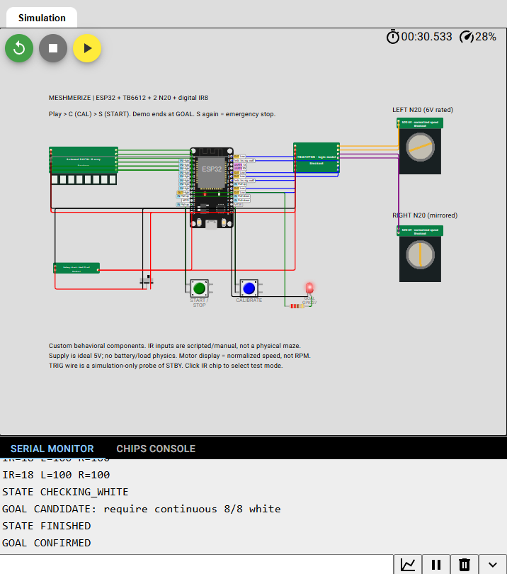
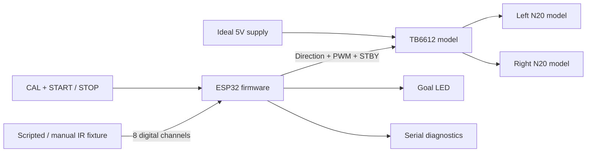

# Meshmerize — ESP32 Maze-Robot Control Simulation

An ESP32 robotics project for exploring digital line sensing, differential motor control, and maze-junction decisions in **Wokwi**. The firmware reads eight IR channels, drives a TB6612FNG model, and controls two simulated N20 motors through PWM.

**[Run the live Wokwi demo](https://wokwi.com/projects/477471643800577025)** · [Wiring](docs/wiring.md) · [Architecture](docs/architecture.md) · [Validation](docs/validation.md)



## What this demonstrates

- **Digital sensing:** eight GPIO inputs, five-read majority sampling, polarity calibration, and weighted line position.
- **PD steering:** separate left/right PWM commands with a mirrored right motor configuration.
- **Explicit control states:** line following, white-region checking, junction analysis, turning, recovery, halt, and finish.
- **Goal discrimination:** all eight sensors must remain white for 1,000 ms; even a seven-white reading cancels the candidate.
- **Turn and recovery logic:** old-line loss followed by center-line reacquisition, timeout/retry protection, and delayed U-turn after persistent line loss.
- **Custom Wokwi components:** an IR input generator, TB6612 logic model, animated N20 model, and ideal supply model.
- **Reproducible evidence:** Wokwi execution logs plus 16 host-side regression scenarios that exercise the actual sketch.

**Scope:** this is an electronics and firmware simulation. Sensor inputs are scripted or manually selected; they are not generated by a robot driving through a physical maze. The firmware is a reconstructed simulation controller, not the original competition sketch. DFS branch memory and shortest-path solving are not implemented.

## Run it in two minutes

1. Open the [live project](https://wokwi.com/projects/477471643800577025).
2. Press **▶ Play** and wait for the serial startup message.
3. Click the blue **CALIBRATE** button, then the green **START / STOP** button.
4. Watch steering corrections, a temporary white junction, a right turn, dead-end recovery, and goal confirmation.
5. Press START again during an active run to halt. Restart the simulator to begin a fresh run.

Alternatively, send `c` and then `s` through the serial monitor. Send `x` to stop.
Click the diagram and press **F** if the circuit is not fully visible.

The demo finishes after approximately nine seconds of scripted sensor time; wall-clock duration depends on simulation speed.

## Components

| Component | Implementation | Purpose |
|---|---|---|
| ESP32 DevKit / WROOM-32 | Native Wokwi MCU | Executes the Arduino C++ sketch |
| Eight-channel digital IR array | Custom C chip | Drives D1–D8 and displays the white mask |
| TB6612FNG | Custom C chip | Direction, PWM, standby, brake and coast logic |
| Two N20 6V-rated motors | Two instances of a custom C chip | Signed PWM measurement and shaft animation |
| Battery / buck rail | Combined ideal supply model | Enabled 5V motor supply |
| START and CAL | Native pushbuttons | Start, emergency halt and polarity calibration |
| Goal LED and 220 Ω resistor | Native components | Latched finish indication |

## Signal flow



There is deliberately no motor-position-to-sensor feedback connection. The gray STBY-to-TRIG wire starts the test fixture and is not a physical IR-board connection.

## Repository layout

```text
sketch.ino                  ESP32 simulation controller
diagram.json                Complete Wokwi wiring
ir8.chip.{c,json}            Digital sensor fixture
tb6612.chip.{c,json}         Motor-driver logic model
n20.chip.{c,json}            Motor visualization and PWM integration
power.chip.{c,json}          Ideal regulated supply
docs/                       Wiring, architecture, validation and evidence
tests/                      Host firmware harness and circuit validation
.github/workflows/check.yml  Automated regression checks
```

Files needed by Wokwi stay at the repository root so they can be imported without rearranging paths. For a new Wokwi project, replace its initial sketch and diagram, then upload the eight custom-chip files. See the [simulation guide](docs/simulation-guide.md).

## Run the checks locally

Requires Python 3 and a C++14-capable `g++` compiler. No Python packages are needed.

```sh
python tests/validate_project.py
mkdir -p build
g++ -std=c++14 -Wall -Wextra -Wno-unused-parameter -I tests/stubs tests/firmware_test.cpp -o build/firmware-test
./build/firmware-test
```

On Windows PowerShell, use `New-Item -ItemType Directory -Force build`, name the executable `build/firmware-test.exe`, and run `./build/firmware-test.exe`.

The host harness stubs GPIO, PWM, serial and time; it tests state transitions and commands. It does **not** emulate the ESP32 instruction set or run Wokwi custom chips. Wokwi compilation and the original interactive run are documented separately in [validation](docs/validation.md).

## Limits and next steps

The simulation does not establish physical maze-solving success, motor torque, calibrated RPM, battery life, electrical safety, or exact turn angles. Motor gearing was unspecified. The ideal rail does not model discharge, regulator behavior or ESP32 brownout.

Next engineering steps are physical sensor/polarity calibration, measured motor and wheel parameters, validated junction handling on a real track, and branch-memory implementation. See [architecture and tradeoffs](docs/architecture.md).

## Provenance and licensing

The simulation was developed with AI assistance from the project's hardware and behavior requirements. The original competition firmware was not available for import. The source here is the reconstructed simulation version; formatting and host-side validation were added for this repository.

No open-source license has been selected. Public visibility is not a grant of permission to reuse or redistribute the code. Wokwi and ESP32 are third-party platforms; this project is not affiliated with their vendors.
