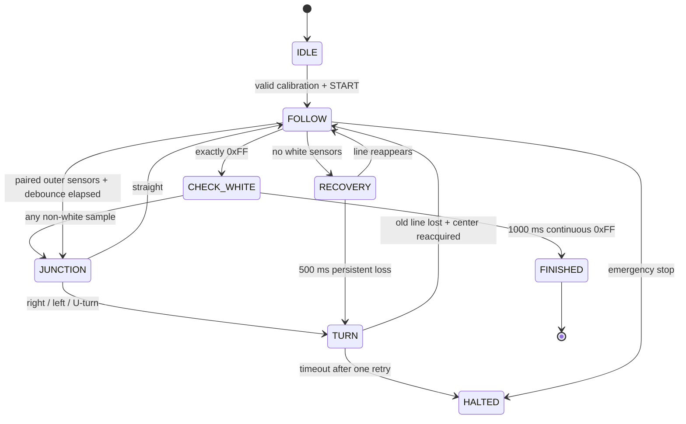

# Controller architecture

The firmware executes a cooperative loop with a 10 ms control interval. Button and serial commands are checked before the interval gate. The sensor reader uses five immediate digital reads per channel and majority selection; this is not a time-spaced debounce filter.

## State transitions

Emergency stop also applies during white checking, junction analysis, turning and recovery. A finished run remains stopped; restart the simulator to reset it.

## Line following

Weights run from −350 at D1 to +350 at D8, in increments of 100. The mean weight of white sensors is the position error. PD correction uses `KP=0.30` and `KD=0.65` on the change in sampled error, capped at ±90. The derivative is per control sample, not normalized by elapsed seconds. A positive error increases left speed and decreases right speed.

Normal following uses base command 100, capped at 165; white checking uses 50. Forward following does not reverse a wheel. Turning uses opposing commands of ±110.

## Goal versus junction

Exactly eight white sensors enter an exclusive white-check state. Any other mask cancels it immediately. The timeout is temporal: 1,000 ms is not a measured distance. A sufficiently broad junction can still satisfy this rule, so a physical robot needs track-specific validation.

Junction analysis accumulates left/right edge evidence over 120 ms, then chooses right, straight, left or U-turn. A cancelled all-white region initializes both branch flags, so this reconstruction can infer branches that have not been independently confirmed. It should not be presented as a proven general-purpose junction classifier.

## Turning and recovery

Turns must observe center-line loss before accepting reacquisition. The minimum turn durations are 160 ms for side turns and 450 ms for U-turns; these gates do not establish exact rotation angles. A 2,200 ms timeout allows one retry, followed by halt. Persistent all-black input first triggers recovery, then a U-turn after 500 ms.

There are no encoders, global map, branch-memory stack or shortest-path replay in this version.

## Custom components

- `ir8`: drives eight pins from a manual mask or a deterministic timed scenario. Its display is an input indicator.
- `tb6612`: responds to direction, PWM and standby changes; models digital brake/coast/drive states without current or voltage-drop physics.
- `n20`: integrates signed bridge states over 20 ms windows, smooths normalized speed and animates a shaft. Mirrored mounting reverses the display convention. No measured motor constant is implied.
- `power`: exposes an ideal enabled 5V source. It does not simulate a specific battery chemistry or converter.

## Improvements to pursue

1. Import and review the actual competition firmware when available.
2. Replace assumed junction evidence with measured branch-confirmation logic.
3. Add physically grounded sensor feedback and wheel dynamics if a motion simulator is needed.
4. Implement branch memory with clearly stated recognition assumptions.
5. Validate on a real track and record reproducible measurements before making hardware-performance claims.
